<p align="center">
  
</p>

<h1 align="center">NetScope</h1>

<p align="center">
  <strong>Android-only, on-device network traffic diagnostics</strong>
</p>

<p align="center">
  
  
  
  
</p>

---

## Contents

- [Contents](#contents)
- [Platform](#platform)
- [What it does](#what-it-does)
- [Tech stack](#tech-stack)
- [Build and run](#build-and-run)
  - [Requirements](#requirements)
  - [Debug build](#debug-build)
  - [Release build](#release-build)
- [APK](#apk)
- [Permissions](#permissions)
- [Privacy](#privacy)

NetScope is a native Android diagnostic app for device owners. It monitors device-level and per-app network usage, active connection metadata, and session throughput entirely on-device.

It is **not** a remote monitoring or interception tool and does not transmit telemetry off the device.

## Platform

| Item | Value |
|---|---|
| Platform | Android only |
| Minimum Android | Android 8.0 (API 26) |
| Target Android | Android 14 (API 34) |
| Package name | `com.netscope.app` |

## What it does

- Shows download/upload rates, session totals, active connections, and network type.
- Lists per-app network usage.
- Records connection metadata such as protocol, IP, port, direction, and packet size.
- Supports standard metrics mode and an optional local VPN header inspection mode.
- Stores settings and history locally on the device.

## Tech stack

| Layer | Technology |
|---|---|
| Language | Kotlin |
| UI | Jetpack Compose, Material 3 |
| AndroidX | Lifecycle, ViewModel, Activity Compose |
| Concurrency | Kotlin Coroutines |
| Settings | SharedPreferences |
| Traffic data | TrafficStats, NetworkStatsManager |
| Metadata inspection | Android VpnService |
| Motion | Compose animations for preloader and transitions |

## Build and run

### Requirements

- Android Studio, or the Android SDK with Gradle.
- JDK 17. The Android Studio bundled JBR is suitable.

### Debug build

```sh
./gradlew assembleDebug
```

On Windows:

```bat
gradlew.bat assembleDebug
```

### Release build

```bat
gradlew.bat assembleRelease
```

Install the generated APK from `app/build/outputs/apk/` using Android Studio or `adb install`.

## APK

- Repository copy: [NETSCOPE.apk](APK/NETSCOPE.apk)
- External location: [INSERT APK URL OR REPOSITORY PATH]

The repository-relative link points to the APK currently stored in the `APK` folder. The external link has not been verified.

## Permissions

| Permission | Purpose |
|---|---|
| `INTERNET` | Network state access |
| `ACCESS_NETWORK_STATE` / `ACCESS_WIFI_STATE` | Detect active network type |
| `FOREGROUND_SERVICE` / `FOREGROUND_SERVICE_DATA_SYNC` | Continuous monitoring service |
| `POST_NOTIFICATIONS` | Monitoring notification |
| `PACKAGE_USAGE_STATS` | Per-app usage attribution |
| `QUERY_ALL_PACKAGES` | Per-app network visibility on Android 11+ |
| VPN consent | Required before VPN metadata mode starts |

## Privacy

All processing happens on the device. NetScope does not capture packet payloads and does not send network data to a remote service.
EOF